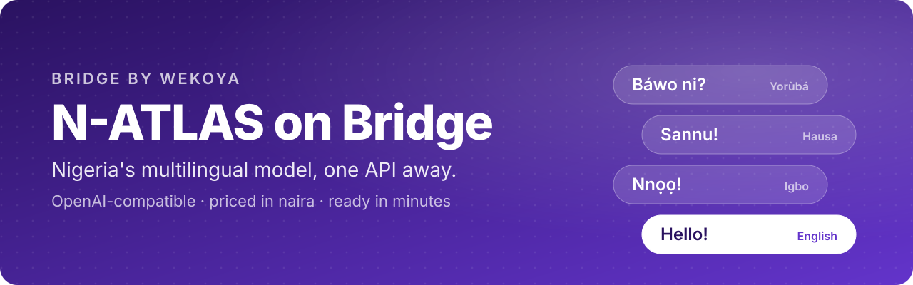
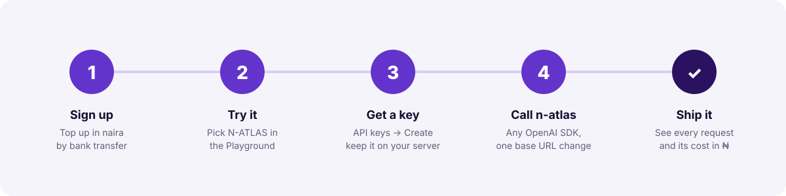
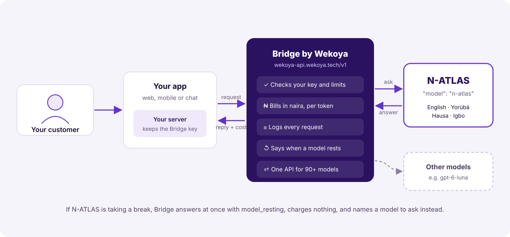
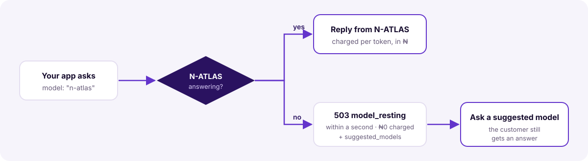

<p align="center">
  
</p>

<p align="center">
  <a href="LICENSE"></a>
  <a href="CONTRIBUTING.md"></a>
  <a href="https://bridge.wekoya.tech/docs/n-atlas"></a>
</p>

# N-ATLAS on Bridge

**N-ATLAS** is Nigeria's multilingual large language model. It understands and writes **English, Yorùbá, Hausa and Igbo**.

**[Bridge by Wekoya](https://bridge.wekoya.tech)** lets any developer use it through one API key, paid for in naira. There's no GPU to rent, no model to download and no server to keep running. If you can call the OpenAI API, you can call N-ATLAS.

This repository has everything you need to get started:

- **Working examples** in curl, Python and JavaScript, plus a small web app.
- **The [technical documentation](docs/technical-documentation.pdf)** (PDF): the API, costs, limits and error handling.
- **A guide to building something real:** a customer-support assistant that answers people in their own language.

> **Status: preview.** N-ATLAS can take a short break now and then. When it does, Bridge tells you at once, charges nothing and names another model to ask. Every example here handles that, so your users always get an answer.

---

## From zero to a working integration

<p align="center">
  
</p>

1. **Create an account** at [bridge.wekoya.tech](https://bridge.wekoya.tech) and top up in naira. A bank transfer to your account number lands in about a minute; card top-ups start at ₦100.
2. **Try N-ATLAS in the Playground.** In the console, open *Playground*, pick **N-ATLAS** and write in any of the four languages.
3. **Create an API key** under *API keys*. Keep it on your server, never in a browser, an app or a repository.
4. **Call it.** Use any OpenAI SDK, set the base URL to `https://wekoya-api.wekoya.tech/v1` and use `"model": "n-atlas"`.
5. **Ship it.** Every request, with its tokens and its cost in naira, shows up in the console.

### The whole integration

```python
from openai import OpenAI

client = OpenAI(
    base_url="https://wekoya-api.wekoya.tech/v1",  # the only change from OpenAI
    api_key="wk_live_...",                          # your Bridge key, from an environment variable
)

reply = client.chat.completions.create(
    model="n-atlas",
    messages=[{"role": "user", "content": "Báwo ni? Ṣàlàyé ohun tí o lè ṣe fún mi."}],
)
print(reply.choices[0].message.content)
```

---

## How it fits together

<p align="center">
  
</p>

Your app talks to **your server**, which holds the Bridge key. Bridge does four things on every request:

- checks the key and your spending limits;
- sends the request to N-ATLAS;
- records the tokens and the cost in naira;
- returns the reply with its cost attached.

## Examples

| Example | What it shows | Run it |
|---|---|---|
| [`examples/curl`](examples/curl) | One request from the terminal | `./chat.sh "Sannu!"` |
| [`examples/python`](examples/python) | The smallest call, then a support assistant with conversation history and fallback | `python support_assistant.py` |
| [`examples/javascript`](examples/javascript) | Streaming, and a support reply with fallback | `node chat.mjs` |
| [`examples/web-support-app`](examples/web-support-app) | A small web chat for a payments company, in four languages, key kept on the server | `node server.mjs` |

Every example reads your key from `BRIDGE_API_KEY`:

```bash
export BRIDGE_API_KEY=wk_live_...
```

## When N-ATLAS takes a break

<p align="center">
  
</p>

You get a `503` within a second, and you are **not charged**:

```json
{
  "error": {
    "type": "model_resting",
    "message": "N-ATLAS is taking a short break. Try again in a few minutes, or switch to another model such as gpt-6-luna.",
    "retryable": true,
    "suggested_models": ["gpt-6-luna"]
  }
}
```

Catch it and ask one of `suggested_models` instead:

```python
from openai import APIStatusError

try:
    reply = client.chat.completions.create(model="n-atlas", messages=messages)
except APIStatusError as error:
    body = error.body if isinstance(error.body, dict) else {}
    problem = body.get("error", body)
    if problem.get("type") not in ("model_resting", "model_unavailable"):
        raise
    fallback = (problem.get("suggested_models") or ["gpt-6-luna"])[0]
    reply = client.chat.completions.create(model=fallback, messages=messages)
```

## What it costs

You pay for the tokens N-ATLAS reads and writes, in naira. There's no subscription, and nothing is charged while you're not using it.

| | Price |
|---|---|
| Input (what you send) | **₦175.50** per million tokens |
| Output (what it writes) | **₦526.50** per million tokens |
| A typical support reply (about 100 tokens in, 50 out) | **about ₦0.05** |
| A request that is refused, or made while N-ATLAS rests | **₦0** |

Prices are current at the time of writing. The live price is always in `GET /v1/models?include=experimental` and in the console. Every reply carries its own cost in `wekoya.cost`.

## Good to know

- **Text only.** Images, audio and files aren't read.
- **Context:** about 8,000 tokens for the conversation and the reply together. Send only the latest turns of a long chat.
- **Reply length:** up to 1,024 tokens unless you set `max_tokens`.
- **No tools or function calling.** A request with `tools` is refused with `tools_not_supported`.
- **Streaming works,** but the reply may arrive in one piece rather than word by word.
- **Catalogue:** preview models are left out of `GET /v1/models` unless you add `?include=experimental`.
- **Never put your key in a browser or mobile app.** Call Bridge from your server, as `examples/web-support-app` does. For apps that must call Bridge directly, see [guest keys](https://bridge.wekoya.tech/docs/guest-keys).

## Documentation

- **[Technical documentation (PDF)](docs/technical-documentation.pdf):** everything on this page in more depth, including every error and its fix, limits, security and production checklists.
- **[N-ATLAS on the Bridge docs](https://bridge.wekoya.tech/docs/n-atlas)**
- **[Bridge quickstart](https://bridge.wekoya.tech/docs/start)** · **[Errors](https://bridge.wekoya.tech/docs/errors)** · **[What it costs](https://bridge.wekoya.tech/docs/pricing)**

## Contributing

Examples in more languages, frameworks and use cases are very welcome. Read [CONTRIBUTING.md](CONTRIBUTING.md) to get started, and please follow our [Code of Conduct](CODE_OF_CONDUCT.md). To report a security problem, see [SECURITY.md](SECURITY.md).

## Licence

[MIT](LICENSE) © Wekoya Ltd. The examples are yours to copy into your own projects.

N-ATLAS is Nigeria's multilingual language model, developed by Awarri with the Federal Government of Nigeria. Bridge by Wekoya provides access to it through an API. This repository contains integration examples only.
